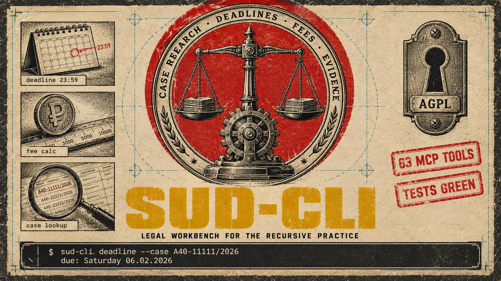

# sud-cli

    


<p align="center"></p>

CLI for Russian-court legal work: case and practice research, procedural deadlines, state
duties, evidence registry, NPAs. Offline-first core, documented live adapters, 65-tool MCP
server.

[ Русский](README.md) · **English**

## Install

```bash
pip install git+https://github.com/lnfnt/sud-cli.git
sud-cli --help
```

Not published on PyPI. Local checkout: `python3 -m venv .venv && . .venv/bin/activate && pip install .`
Python >= 3.10, zero runtime dependencies.

## Features

- **Case research** — one query over official sources (sudact, publication.pravo.gov.ru,
  arbitration case card index), case cards and timelines (kad), practice lookup by case
  number and dispute subject.
- **Counterparty card (EGRUL/EGRIP)** — FNS open registries (art. 6 of 129-FZ); no captcha,
  no protected endpoints.
- **Insolvency check** — primary path via the arbitration case index; EFRSB re-check runs as
  a manual, provenance-recorded flow (`efrsb link` / `efrsb record`).
- **FSSP semi-auto** — `fssp assist` opens the enforcement bank, fills and submits the form;
  **a human solves the captcha**. Verdict enters the case evidence registry with full
  provenance. Manual `fssp check` always available.
- **Deadlines & fees** — GPK/APK/KAS RF date calculus with the production calendar; duty
  tariffs in reviewable JSON rule files.
- **Case dossier** — documents with versions, representatives, evidence, deadlines, drafts;
  export; idempotent purge confined to the state directory.
- **VS/VAS rulings corpus** — `plenum list | plenum search`.
- **MCP server** — `sud-cli mcp`, 65 tools.
- **§13 AGPL** — `sud-cli license`: license, build provenance, source access.

## Commands (Chain · Reps · Conflicts · Reports · Backup · Metrics · Purge)

```
sud-cli deadlines chain А40-11111/25            # procedural deadline chain (Chain)
sud-cli case rep add | case rep list            # representatives registry (Reps)
sud-cli calendar conflicts                      # hearing conflicts (Conflicts)
sud-cli report portfolio / report case          # reports (Reports)
sud-cli backup create | backup verify | backup restore   # backup lifecycle (Backup)
sud-cli case export / case purge / metrics      # export, purge, metrics (Metrics, Purge)
sud-cli fssp assist --kind ur --inn 7704361225  # FSSP semi-auto
sud-cli efrsb link --kind ul --inn 7704361225   # EFRSB manual flow
sud-cli plenum list | plenum search ТЕКСТ       # VS/VAS corpus
sud-cli mcp                                     # MCP server (65 tools)
sud-cli license                                 # §13 AGPL
```

## Registry sections

| Section | Contents |
|---|---|
| **Evidence** | evidence with provenance: who, when, method, attached file |
| **DocHistory** | document versions inside a case |
| **Checklist** | checklists generated from rule files |
| **Forms** | procedural form templates and fill helpers |

## Limits

- No automated filing, by design: submissions are made by a human.
- Practice search works on formal attributes; case-law assessment stays with the lawyer.
- Not legal advice.

## Network policy

Live adapters route through your proxy (`SUD_EGRESS_PROXY`) with fail-closed DNS pinning;
rate-limited hosts enter cooldown automatically. Automated captcha solving is forbidden by
construction.

## Verify the release

<details>
<summary>Checksums and GPG</summary>

```bash
sha256sum -c SHA256SUMS
gpg --import release_pub.asc
gpg --verify sud_cli-0.1.0.tar.gz.asc   # fingerprint F4492D47B75F12D025400C19291E4ACACA58902A
```
</details>

## Contributing & license

AGPL-3.0-only; DCO sign-off required; owner retains relicensing rights (CONTRIBUTING.md).
Vulnerabilities: report privately (SECURITY.md).

Author and copyright holder: [lnfnt](mailto:lnfnt@proton.me).

Author and copyright holder: [lnfnt](mailto:lnfnt@proton.me).
